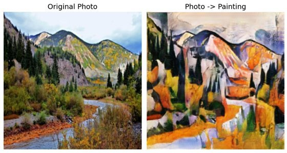

<h1 align="center">Hi, I'm Mahdi Ahmadi 👋</h1>

  <b>AI / Machine Learning Engineer</b> · M.Sc. Computer Science at <b>TU Berlin</b> 
  Speech &amp; audio · Computer vision · NLP &amp; LLMs, with the backend skills to ship them

  
  

I build deep-learning systems end to end, from the data and the model to an honest evaluation and tested code.
A 10-month backend internship (FastAPI, PostgreSQL) taught me how to put models into production.
I speak English (C1), German (A2) and Persian, and I'm based in Berlin, open to working-student roles in AI/ML.

### 🚀 Featured projects

  
  
  

| Project | Result | Stack |
|---|---|---|
| 🔊 [Speech Enhancement U-Net](https://github.com/mahdi-ahmadi-2002/Unet-Audiomnist-Denoiser) | **+10.9 dB SI-SDR** on unseen speakers, 2× a Wiener filter | PyTorch, DSP |
| 🚗 [Vehicle Speed from Dashcam](https://github.com/mahdi-ahmadi-2002/Vehicle-Speed-Estimation) | **≈ 0.5 m/s** mean error from optical flow, CNN + GRU | PyTorch, OpenCV |
| 🎨 [Landscape → Painting CycleGAN](https://github.com/mahdi-ahmadi-2002/Style-Transfer-Landscape2Art) | Built from scratch, 7 art styles, no paired data | PyTorch, GANs |
| 🧾 [Code Summarization](https://github.com/mahdi-ahmadi-2002/CodeBART-Code-Summarization) | PLBART vs. CodeT5 with a data-leakage audit | Hugging Face |
| ⚙️ [FastAPI-Blog](https://github.com/mahdi-ahmadi-2002/FastAPI-Blog) | **56× faster** search, 107 tests, 97% coverage | FastAPI, PostgreSQL, Docker |

### 💼 Experience

- **Research Assistant, Applied AI**: GPT-based speech interview agent and RAG assistant, Shahid Beheshti University *(2024–25)*
- **Junior Developer Intern**: REST APIs, async Python and PostgreSQL tuning, MTN Irancell *(2024–25)*
- **Teaching Assistant** for 8 courses, incl. Neural Networks and Machine Learning *(2022–25)*

### 🛠️ Tech stack

